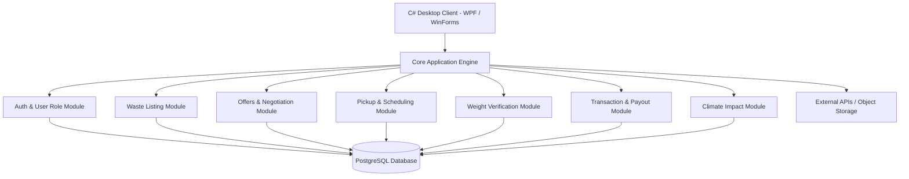

# ABAH — Aplikasi Penukar Limbah

A digital circular-waste platform that connects waste generators with collectors and processors to divert recyclable materials from landfills, support local waste economies, and advance Sustainable Development Goal 13 (Climate Action).

---

## 🤝 Contribution Guidelines

To maintain code quality and ensure a smooth workflow across the development lifecycle, all group members must strictly adhere to the following contribution rules.

### Team Roles & Responsibilities
* **Akhnaf Fawzan Yogatrisna** (Software Architect) — System architecture, module boundaries, UML modeling, and database schema design.
* **Rafi Busthami** (Frontend Developer) — UI/UX implementation, client-side application logic, and user workflow integration.
* **Akmal Rafli Fauzan** (Backend Developer) — API design, database ORM integration, business logic, and third-party service integration.

### Branching Strategy
* **Naming Pattern:** `<type>/<short_description>.<your_name>`
* **Examples:** `feature/navbar.akmal`, `fixing/weight-calculator.rafi`

| Type | Purpose |
| :--- | :--- |
| `feature/` | Developing new application capabilities or UI components |
| `fixing/` | Bug fixes, patch resolution, and error corrections |

### Commit Message Conventions
We follow a simplified [Conventional Commits](https://www.conventionalcommits.org/) format:

**Pattern:** `<type>(<scope>): <short_summary>`

| Type | Description |
| :--- | :--- |
| `feat` | Adding a new feature or major capability |
| `fix` | Resolving a bug or error |
| `docs` | Modifying project documentation or comments |
| `style` | Formatting, CSS/UI layout tweaks without logic changes |
| `refactor` | Restructuring internal code without altering behavior |

### Pull Request & Code Review Workflow
1. Push your local working branch to the remote repository.
2. Open a Pull Request (PR) targeting the `main` branch.
3. Include a clear description of the changes made.
4. Require a review and approval from at least one teammate prior to merging.

---

## 1. Project Overview & Academic Requirements

This project is developed as part of the Junior Project lab sequence (*Teknik Basis Data, Pemrograman Berbasis Objek*) under the primary theme of **Climate Action**.

### Course Constraints & Requirements
* **Theme Alignment:** Climate Action (UN Sustainable Development Goal 13) — focused on environmental protection, waste diversion, and carbon footprint reduction.
* **Core Technology Stack:** C# (.NET Framework / .NET Core) for desktop application development using Windows Presentation Foundation (WPF), Windows Forms (WinForms), or Windows App SDK.
* **Database & Third-Party Integration:** PostgreSQL database integration for persistent storage, complemented by external API integrations (e.g., mapping services, cloud storage).
* **Evaluation Scheme:**
  * **Process Assessment (40%):** Weekly milestones and lab evaluations managed by Teaching Assistants.
  * **Product Assessment (60%):** Final software demo and architecture evaluation conducted by Supervising Lecturers and the Academic Coordinator.

---

## 2. Problem Statement & Proposed Solution

### Problem
Domestic and commercial waste (cardboard, paper, plastic, glass, aluminum cans, used cooking oil) frequently ends up in landfills due to a lack of structured distribution channels. Waste producers lack visibility on nearby recycling options, while waste collectors struggle with inefficient material sourcing, non-transparent weighing processes, and lack of post-collection tracking.

### Solution
**ABAH** acts as a digital marketplace connecting waste generators directly with collectors and recycling processors. The platform streamlines waste categorization, listing creation, price negotiation, pickup scheduling, scale weight verification, and transparent transaction management.

---

## 3. Core MVP Features

1. **User Accounts & Dynamic Roles:** Supports registration across multiple user roles (`WasteProducer`, `Collector`, `Processor`, `CommunityPartner`) where a single account can hold multiple roles.
2. **Waste Listing:** Producers create detailed posts specifying material category, estimated weight, photo evidence, pickup location, and donation or trade preference.
3. **Search & Material Matching:** Filter available listings by category, location distance, volume, condition, and availability.
4. **Offers & Price Negotiation:** Collectors submit offers with custom material pricing, pickup fees, and target pickup times.
5. **Pickup Scheduling & Tracking:** Manage pickup windows across distinct statuses (`requested`, `accepted`, `on_the_way`, `collected`, `verified`, `completed`).
6. **Weight Verification System:** Transparently records estimated versus actual scale weights, including scale photo evidence uploading before final payout calculation.
7. **Transaction & Financial Tracking:** Automatic payment total calculations based on verified weights, transaction receipts, and digital settlement logs.
8. **Climate Impact Dashboard:** Visualizes total kilograms diverted from landfills, active environmental contribution metrics, and transaction history.

---

## 4. Software Architecture

ABAH uses a clean **Modular Monolith Architecture** built on top of C# / .NET, ensuring strong separation of concerns across core domain entities while simplifying local deployment and desktop execution.


## 5. Class Diagram
```classDiagram
    class User {
        +int id
        +string name
        +string email
        +string passwordHash
        +string phoneNumber
        +string address
        +string locationCoords
        +UserRole[] roles
        +rateUser()
    }

    class UserRole {
        <<enumeration>>
        WASTE_PRODUCER
        COLLECTOR
        PROCESSOR
        COMMUNITY_PARTNER
    }

    class ImpactRecord {
        +int impactId
        +float wasteDivertedKg
        +int environmentalPoints
        +int transactionCount
    }

    class WasteListing {
        +int listingId
        +string materialType
        +float estimatedWeight
        +string condition
        +string photos
        +string pickupLocation
        +string status
        +date createdAt
        +createOffer()
    }

    class Offer {
        +int offerId
        +float proposedPrice
        +float pickupFee
        +string pickupSchedule
        +string status
    }

    class PickupSchedule {
        +int scheduleId
        +datetime scheduledTime
        +string status
    }

    class WeightVerification {
        +int verificationId
        +float estimatedWeight
        +float actualWeight
        +string photoEvidence
        +string scaleId
    }

    class Transaction {
        +int transactionId
        +float finalWeight
        +float totalPayment
        +string transactionStatus
        +string paymentMethod
    }

    %% Relationships
    User "1" --> "1..*" UserRole : has roles >
    User "1" --> "0..*" ImpactRecord : records >
    User "1" --> "0..*" WasteListing : creates >
    User "1" --> "0..*" Offer : submits >

    WasteListing "1" <-- "0..*" Offer : targets
    WasteListing "1" --> "1" PickupSchedule : schedules >

    PickupSchedule "1" --> "1" WeightVerification : verifies >

    Offer "1" --> "1" Transaction : generates >
    WeightVerification "1" --> "1" Transaction : validates >

```
## 6. Tech Stack & Environments 
Language & Runtime: C# / .NET SDK 10.0+

User Interface: Windows Presentation Foundation (WPF) / WinForms

Database: PostgreSQL managed via pgAdmin

Version Control: Git & GitHub

Development IDE: Visual Studio Code
## Module 8 — Submit an offer

The WPF Offers window reads waste listings and demo collectors from PostgreSQL,
creates an offer through the C# domain method, and shows the latest 25 saved
offers. Collector selection is for the demo and does not require an account.
Enter the proposed offer amount in rupiah and a pickup fee from zero through the
proposed amount. Enter the pickup date and time in your local time zone.

### Run the WPF workflow demo on development

Create a PostgreSQL database named `abah`. Run the three scripts in order in
pgAdmin, or from the repository root with psql:

```powershell
psql -h localhost -U YOUR_USER -d abah -v ON_ERROR_STOP=1 -f database/001_offers.sql -f database/002_demo_seed.sql -f database/003_workflow.sql
$env:ABAH_POSTGRES_CONNECTION = 'Host=localhost;Port=5432;Database=abah;Username=YOUR_USER;Password=YOUR_PASSWORD'
dotnet run --project src/ABAH.Desktop
```

Start Visual Studio from an environment that has the same connection variable
if using F5. Use test data only. Settings switches demo roles locally and the
desktop connects directly to PostgreSQL. This prototype has no authenticated
accounts or API authorization. The original Module 8 offers remain in the
legacy offers table and use their original price semantics.

1. In Waste Listings, publish a 12.50 kg Trade listing as Producer.
2. In Settings, select a demo collector. Return to Waste Listings, select the
   listing and submit a future WIB pickup at Rp 4,000/kg with a Rp 5,000 fee.
3. Switch to Producer. Open Offers, check the Rp 45,000 estimate and accept.
4. Switch to the same Collector. In Pickups mark the pickup collected. In
   Verification attach a sample JPEG or PNG and submit 12.20 kg.
5. Switch to Producer. In Verification view the scale photo, confirm the
   measured weight or request a correction. A corrected submission replaces the current demo evidence.
6. Switch to Collector. In Transactions record an external payment reference.
   Switch to Producer and acknowledge it. Verify Rp 43,800 measured net and
   the completed 12.20 kg in Impact. Restart and verify the data persists.
7. Repeat with Donation. The offer has zero rate and fee, and confirmation
   completes the pickup without a payment step.

Use pgAdmin to inspect waste_listings and workflow_offers. The final release
design in docs/ABAH-Release-Design.md describes additional account and API work.
